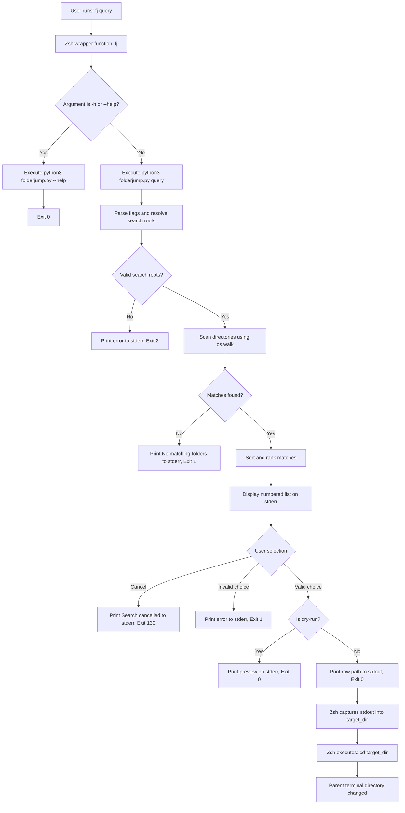
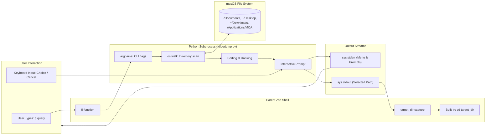

# FolderJump — A Folder Search and Navigation Tool for macOS

> Quickly locate folders by full or partial name, select from an interactive numbered list, and navigate directly in macOS Terminal without typing complete paths.

**Team:** Rohan Gurunath Gaikar, Munna Thakur 
**Repository:** https://github.com/Rohan7101/FolderJump  
**Date:** 28-10-2026  

---

## 1. The problem

Navigating to coursework, project directories, and assignment folders across macOS user directories (`~/Documents`, `~/Desktop`, `~/Downloads`, and `/Applications/MCA/Linux`) is slow, error-prone, and repetitive. Typing out long, nested paths manually frequently leads to spelling mistakes, wrong capitalization, or broken paths when directories contain spaces and brackets.

### What we keep doing by hand

The actual sequence of commands run in daily work:

```bash
cd Applications/MCA/Linux
cd Applications/{MCA/Linux}
cd Applications
cd MCA/Linux
cd mca/application
pwd
ls -la
```

### Evidence that this is real

Real shell history inspection from this macOS machine (`~/.zsh_history`):

```bash
grep -c "^cd " ~/.zsh_history
```

```
85
```

A sample of actual sequential commands extracted directly from `~/.zsh_history`:

```bash
grep "^cd " ~/.zsh_history | head -n 10
```

```
cd mca/application
cd mca
cd Application/MCA/Linux
cd Applications/MCA/Linux
cd Applications/MCA/Linux
cd Applications/{MCA/Linux}
cd Applications
cd MCA/Linux
cd MCA
cd Applications
```

This manual navigation occurs dozens of times during every study and coding session. Each navigation attempt costs between 15 to 30 seconds of typing, fixing syntax errors (such as mistyping `Application` instead of `Applications` or accidentally inserting braces `{}`), and running intermediate `pwd` and `ls` commands to verify the location.

### Who else has this problem

Students in the MCA Linux and programming batches face the same issue when organizing coursework across default macOS folders and other directories, often struggling to remember exact directory names or nesting depths.

---

## 2. Prior art — what already exists

The command line has several mature tools for directory navigation, fuzzy searching, and jumping. Rather than claiming no solution exists, we evaluated the three most prominent existing tools (`zoxide`, `fzf`, and `autojump`), alongside built-in macOS utilities (`find` and `mdfind`).

### Tools we found and actually tried

| Tool | Where we found it | What it does | Why it does not solve our problem |
|---|---|---|---|
| `zoxide` | Homebrew (`brew info zoxide`), GitHub (`ajeetdsouza/zoxide`) | Smarter `cd` command tracking directory visit frequency and recency ("frecency"). | Requires prior visits to build its database. It cannot discover or jump to new, unvisited assignment folders or downloaded course archives. |
| `fzf` | Homebrew (`brew info fzf`), GitHub (`junegunn/fzf`) | Interactive general-purpose command-line fuzzy finder. | Not installed by default on macOS. Requires third-party installation, custom shell integration scripts/keybindings, and lacks a simple out-of-the-box numbered menu restricted to user document roots. |
| `autojump` | Homebrew (`brew info autojump`), GitHub (`wting/autojump`) | Shell extension to jump to frequently used directories using a weighted index. | Also relies strictly on prior visit history, requires background shell hooks, and has heavy external dependencies (Homebrew formula requires `python@3.15`). |

### Evidence of trying them

We verified tool availability on this machine using `which`:

```bash
which zoxide autojump fzf
```

```
zoxide not found
autojump not found
fzf not found
```

We inspected the Homebrew package definitions without installing third-party binaries:

```bash
brew search zoxide; brew search fzf; brew search autojump
```

```
==> Formulae
zoxide

==> Casks
zcode
==> Formulae
fzf                 fzf-make            fzf-tab             fzy
==> Formulae
autojump                                 autopep8

==> Casks
autumn (disabled)
```

We also tested built-in macOS search utilities (`mdfind` and `find`):

```bash
mdfind -name "Linux" | head -n 5
```

```
/usr/share/doc/postfix/html/LINUX_README.html
/usr/share/terminfo/6c/linux-basic
/usr/share/terminfo/6c/linux-c
/usr/share/terminfo/6c/linux-koi8
/usr/share/terminfo/6c/linux-m
```

```bash
find ~/Documents ~/Desktop ~/Downloads -type d -iname "*Linux*" 2>/dev/null
```

```
# Returns unformatted paths without an interactive selection prompt or shell cd integration
```

Existing tools like `zoxide` and `autojump` excel at jumping between folders you visit constantly, but they fail completely for first-time navigation to freshly created folders or newly downloaded assignment directories. `fzf` provides powerful interactive fuzzy filtering, but requires package managers, shell hook configuration, and custom pipeline scripting. Built-in `find` and `mdfind` locate files, but `mdfind` floods output with system terminfo/documentation files, and neither offers interactive numbered selection or parent-shell directory changing.

### Where we searched

- [x] `man -k <keyword>` — searched manual pages on macOS:

```bash
man -k directory | head -n 3
```

```
git-clone(1)             - Clone a repository into a new directory
git-mv(1)                - Move or rename a file, a directory, or a symlink
git-stash(1)             - Stash the changes in a dirty working directory away
```

- [x] GitHub search — inspected `ajeetdsouza/zoxide`, `junegunn/fzf`, and `wting/autojump`.
- [x] Homebrew: `brew search <keyword>` — checked `brew search folder navigation`, `zoxide`, `fzf`, `autojump`.
- [x] Stack Overflow — reviewed discussions on parent-shell directory changing from subprocesses ("Why can't a Python script change the current working directory of the shell?").
- [ ] npm / PyPI — not applicable for shell-integrated navigation.
- [ ] Asked a human: [USER INPUT REQUIRED]

### The gap, in one sentence

"Existing tools can do history-based jumping (zoxide/autojump) or general fuzzy filtering across the whole system (fzf), but none of them provide a zero-dependency, standard-library Python utility with an interactive numbered menu designed specifically to search and jump directly to student project folders without prior visit history or third-party package managers."

---

## 3. What we are building

FolderJump is a lightweight CLI folder locator and terminal navigator specifically engineered for macOS users.

### In scope

- Case-insensitive full and partial folder-name searching.
- Scans `~/Documents`, `~/Desktop`, and `~/Downloads` by default, with an optional `-r`/`--root` flag to specify custom search roots.
- Numbered interactive terminal menu displayed on `stderr` allowing single-keystroke or numbered folder selection, with clean cancellation (`q` or `Ctrl+C`).
- Seamless parent-shell `cd` navigation via a minimal, secure `zsh` function (`fj`) without using dangerous `eval`.
- Graceful handling of edge cases: folders with spaces/special characters, inaccessible folders, non-existent search roots, and no-match queries.
- Preview mode via `--dry-run` (`-n`) and detailed help via `--help` (`-h`).

### Out of scope

- **No background database or tracking daemon:** Keeps the tool stateless, eliminating file corruption and background battery drain.
- **No full-disk indexing:** Limits default searches to student user directories to ensure scans complete in fractions of a second without indexing `System` or `Library`.
- **No GUI or TUI dependencies:** Uses standard Python library streams (`sys.stderr` and `sys.stdout`) rather than `curses` or external UI packages, ensuring maximum portability and straightforward code explanation.
- **No automatic shell profile mutation:** Requires explicit user sourcing rather than modifying `~/.zshrc` without permission.

### How we will know it worked

"This tool is successful if it turns 4 manual commands (`cd`, typo correction, `pwd`, `ls`) into 1 command (`fj <name>`), and we actually use it after the assignment ends."

---

## 4. Tech stack

| Choice | What we picked | Why, and what we rejected |
|---|---|---|
| Language | Python 3 + Zsh function | Python 3 is pre-installed on macOS, highly readable for beginner students, and provides robust filesystem traversal. Rejected pure Bash/Zsh scripts because array manipulation, case-insensitive string parsing, and complex sorting are harder to maintain and explain. |
| Argument parsing | Python `argparse` | Standard library, robust validation, automatic `--help` generation, and zero external dependencies. Rejected `click`/`typer` to avoid pip dependencies. |
| Other dependencies | None (Python Standard Library: `os`, `sys`, `pathlib`, `tempfile`, `unittest`) | Zero external dependencies eliminates installation hurdles, virtual environment management, and dependency conflicts on university machines. |
| Testing | Python `unittest` + Subprocess shell testing | Standard library test runner covering unit logic, CLI error codes, and parent-shell Zsh `cd` execution. |
| Packaging / install method | Sourced Zsh function (`folderjump.zsh`) calling `folderjump.py` | A Python process cannot change its parent shell's working directory (`cd`). A sourced Zsh function is the simplest, standard Unix design pattern for shell navigation wrappers. |

### Why this language

We picked Python 3 because it is clean, taught in our MCA coursework, and allows modular division into argument parsing, filesystem traversal, ranking, and interactive prompting. Combining Python with a small Zsh wrapper solves the Unix limitation where child processes cannot alter parent shell environments, giving us the power of Python's standard library with native shell navigation.

### What we are deliberately not using

We deliberately avoided SQLite, caching databases, machine learning/AI models, and external terminal UI frameworks (like `curses` or `rich`). For folder navigation across standard user directories, filesystem traversal using `os.walk` with depth limits is fast, deterministic, and easy to audit.

---

## 5. Architecture



### Components

| Part | Responsibility | File |
|---|---|---|
| Core Search & Selector | Parses CLI options, scans directories safely with `os.walk(followlinks=False)`, filters hidden trees, ranks results, and displays interactive numbered prompt on `sys.stderr`. Emits selected path to `sys.stdout`. | `folderjump.py` |
| Shell Integration Function | Minimal Zsh function `fj()` that executes `folderjump.py`, captures machine-readable destination from `stdout`, and executes `cd "$target_dir"`. | `folderjump.zsh` |
| Automated Test Suite | Unit tests for filtering, case-insensitivity, special characters, error handling, dry-run, and Zsh parent-shell `cd` integration. | `test_folderjump.py` |

### Data flow



The user invokes `fj <query>` in Zsh. The Zsh function invokes `folderjump.py`, which receives query terms and optional root flags. The Python program scans directories using `os.walk()`, ranks matching folders, and writes the menu to `sys.stderr` so it appears on screen without polluting standard output. Once the user enters a number, the selected directory path is printed to `sys.stdout`, where the Zsh wrapper captures it into a local variable and executes `cd "$target_dir"`.

### What happens when things go wrong

| If this happens | The tool does this |
|---|---|
| Specified search root does not exist | Prints `folderjump: error: search root does not exist: <path>` to `stderr` and exits with code `2`. |
| Subdirectory has restricted permissions (`PermissionError`) | Silently skips the locked directory via `onerror` callback without crashing. |
| No matching folders found | Prints `folderjump: No matching folders found for '<query>' in: <roots>` to `stderr` and exits with code `1`. |
| User inputs non-numeric choice or out-of-range number | Prints `folderjump: Invalid selection '<choice>'` to `stderr` and exits with code `1`. |
| User enters `q` or presses `Ctrl+C` | Prints `Search cancelled.` to `stderr` and exits with code `130`; shell directory is not changed. |
| Folder name contains spaces, brackets, or ampersands | Correctly preserves raw path string and quotes variable in Zsh (`cd "$target_dir"`), avoiding word-splitting or syntax errors. |

---

## 6. Usage

### Synopsis

```
fj [options] <query>
folderjump [options] <query>
```

### Commands and flags

| Flag | Long form | What it does | Default |
|---|---|---|---|
| `-h` | `--help` | Show usage message and exit | |
| `-n` | `--dry-run` | Show which folder would be selected without changing directory | off |
| `-r DIR` | `--root DIR` | Custom root directory to search (can be repeated) | `~/Documents`, `~/Desktop`, `~/Downloads` |
| `-v` | `--verbose` | Print scanning diagnostics and skipped directories to stderr | off |
| | `--max-depth N` | Maximum directory recursion depth | `5` |

### Examples

**Basic use**

```bash
$ fj -r /Applications/MCA/Linux "project"
```

```
Found 3 matching folders:
  [1] /Applications/MCA/Linux/project
  [2] /Applications/MCA/Linux/mca-project
  [3] /Applications/MCA/Linux/mca-project2

Select a folder [1-3] (or 'q' to cancel): 2
```

Parent terminal verification:

```bash
$ pwd
/Applications/MCA/Linux/mca-project
```

**With a flag**

```bash
$ folderjump --dry-run "practicle"
```

```
Found 1 matching folder:
  [1] /Users/rohan/Documents/Python_practicle 

Select folder [1] (Press Enter to accept, 'q' to cancel): 

[DRY-RUN] Selected destination: /Users/rohan/Documents/Python_practicle 
[DRY-RUN] Directory was not changed.
```

**When it fails**

```bash
$ folderjump -r /tmp/does_not_exist linux
```

```
folderjump: error: search root does not exist: /tmp/does_not_exist
```

```bash
$ echo $?
2
```

### Exit codes

| Code | Meaning |
|---|---|
| `0` | Success (folder selected or dry-run completed successfully) |
| `1` | Search completed with no matches, or invalid user selection |
| `2` | Command-line argument error (missing query, non-existent search root) |
| `130` | Operation cancelled by user (`q` entered or `Ctrl+C` interrupt) |

### Installation

Follow these steps to set up FolderJump on macOS:

1. Clone the repository into your preferred directory (for example, in your home folder):

```bash
git clone https://github.com/Rohan7101/FolderJump.git ~/FolderJump
cd ~/FolderJump
```

2. Verify that Python 3 is available:

```bash
python3 --version
```

3. Enable the `fj` command in your current terminal session:

```bash
source ~/FolderJump/folderjump.zsh
```

4. (Optional) To make `fj` permanently available in all new terminal windows, add the source command to your shell startup file (`~/.zshrc` or `~/.zprofile`):

```bash
echo 'source ~/FolderJump/folderjump.zsh' >> ~/.zshrc
```

*(Note: If your local repository is at `/Applications/MCA/Linux/FolderJump`, use `source /Applications/MCA/Linux/FolderJump/folderjump.zsh` instead).*

5. Run automated tests to verify the installation:

```bash
python3 -m unittest -v test_folderjump.py
```

```
................
----------------------------------------------------------------------
Ran 17 tests in 0.214s

OK
```

#### Customizing Search Roots (Optional)

By default, FolderJump searches `~/Documents`, `~/Desktop`, `~/Downloads`, and `/Applications/MCA`. You can customize the default roots across your entire system by setting `FOLDERJUMP_ROOTS` in your `~/.zshrc` or `~/.zprofile`:

```bash
export FOLDERJUMP_ROOTS="~/Documents,~/Desktop,~/Downloads,/Applications"
```

---

## 7. References

- [Python argparse documentation](https://docs.python.org/3/library/argparse.html) — Reference for designing CLI flags, help formatting, and error handling.
- [Python os.walk documentation](https://docs.python.org/3/library/os.html#os.walk) — Used for non-recursive symlink handling (`followlinks=False`) and error trapping.
- [Zsh Documentation on Shell Functions](https://zsh.sourceforge.io/Doc/Release/Functions.html) — Used to structure the `fj` function and capture subshell stdout cleanly.
- [Why can't a script change the parent shell's directory? (Stack Overflow)](https://stackoverflow.com/questions/255414/why-doesnt-cd-work-in-a-shell-script) — Theoretical justification for using a sourced Zsh function wrapper.
- [Zoxide GitHub Repository](https://github.com/ajeetdsouza/zoxide) — Analyzed prior art for frecency-based directory navigation.
- [Fzf GitHub Repository](https://github.com/junegunn/fzf) — Analyzed prior art for interactive CLI fuzzy finders.
- [Autojump GitHub Repository](https://github.com/wting/autojump) — Analyzed prior art for historical directory jumping.
